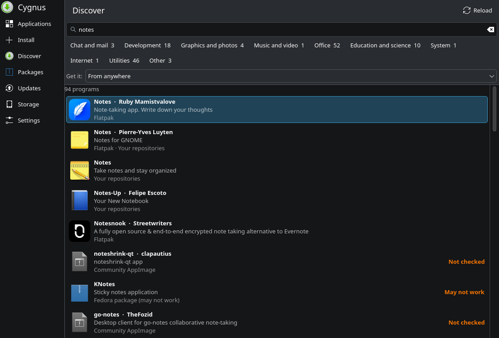
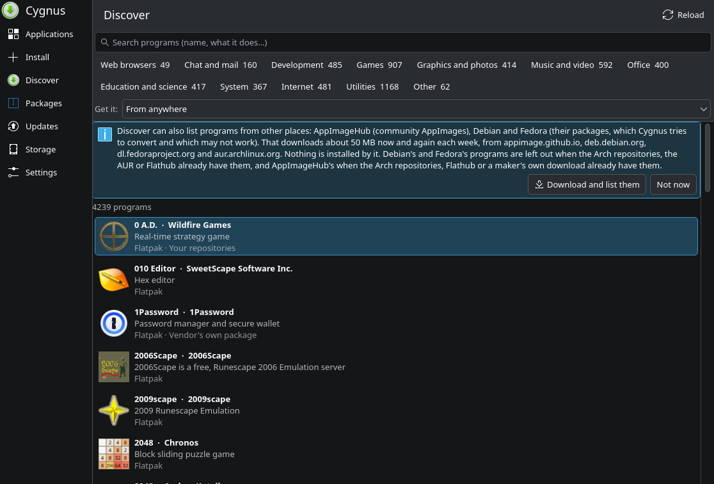
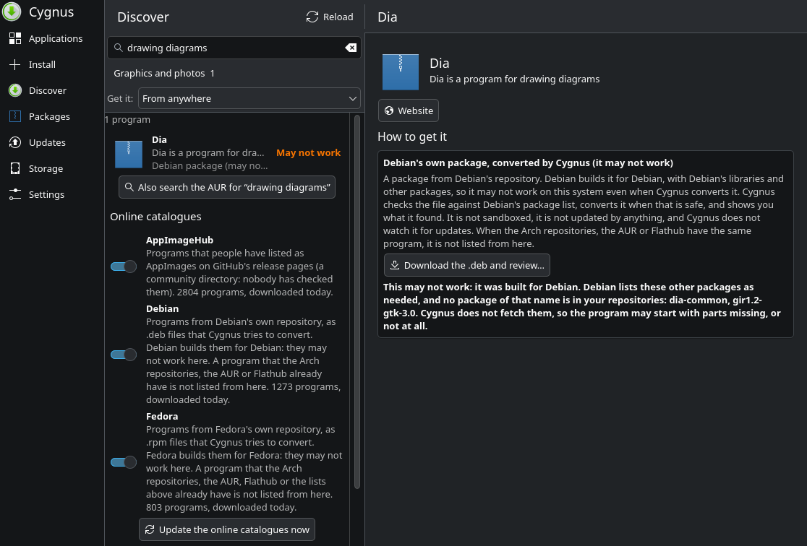
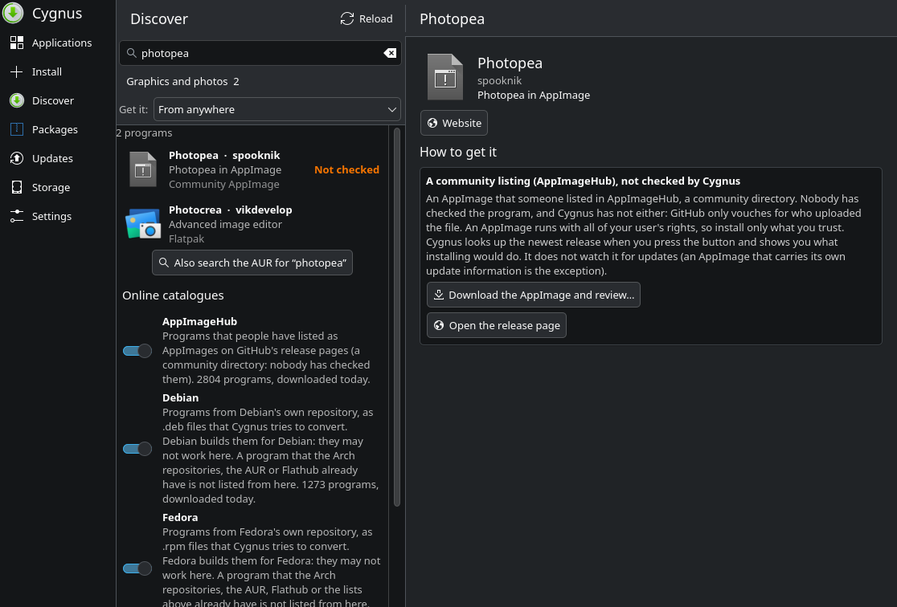
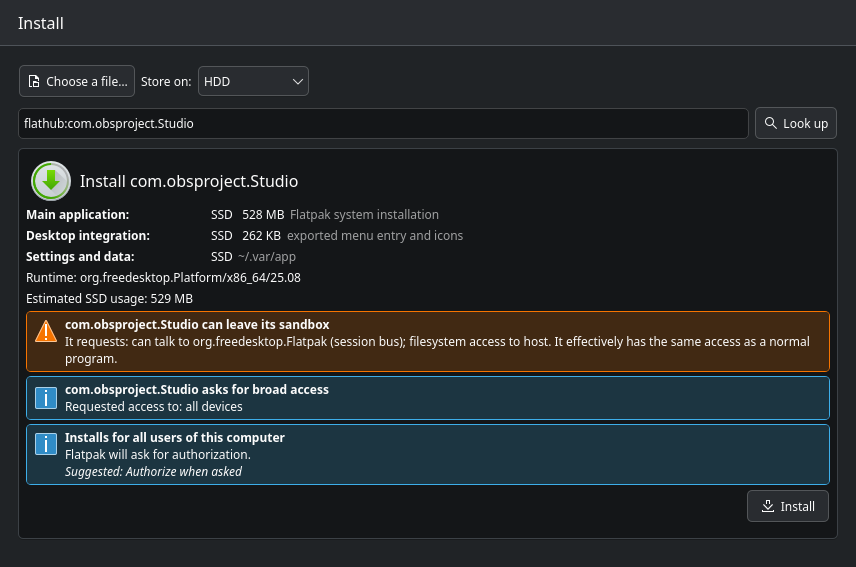
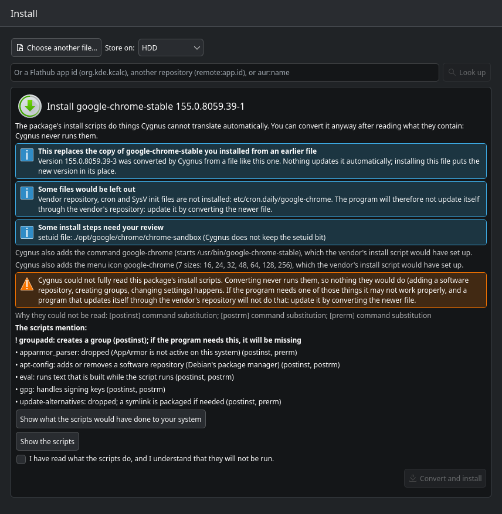
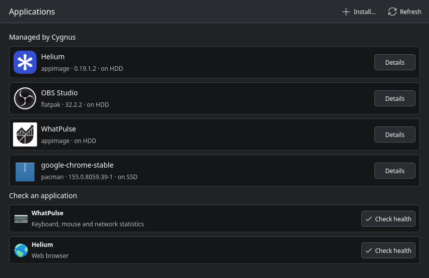
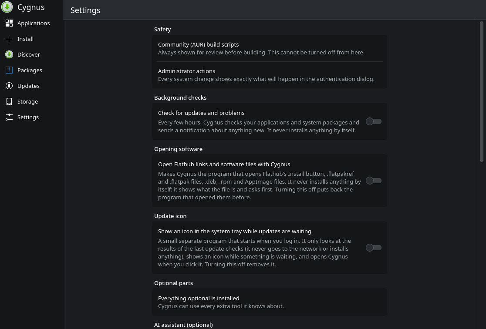

# Cygnus

An application installer and manager for CachyOS / KDE Plasma. You choose where each application
lives (for example SSD or HDD). Cygnus resolves runtimes and dependencies, finds the companion
components an application needs, checks that everything works, and can always finish or undo what
it started.

> **Public beta, version 0.2.0** ([what is new](CHANGELOG.md)). Cygnus works and is used daily by its author, but it has **not had an independent human security review**,
> it has been tested on one setup (CachyOS, KDE Plasma, x86_64), and it contains a small program that runs as
> administrator (the helper) to install and remove packages. Every change to your system shows exactly what it will do
> and asks for your approval first, but treat it as a beta: read the confirmations, keep backups of what matters, and
> please report what you find (see "Reporting a problem" below). The limits are listed in the
> [user guide](docs/user-guide.md#what-cygnus-cannot-do-known-limits); how to review the security-critical part is in the
> [audit guide](docs/audit-guide.md).

* App ID: `io.github.omranabdulaziz.Cygnus`
* License: GPL-3.0-or-later. You can get a ready-made package from [Gumroad](https://azizomran.gumroad.com/l/jtudib) (free during the beta) or build Cygnus yourself.
* Documentation:
  * [User guide](docs/user-guide.md)
  * [Security model](docs/security.md)
  * [Guide for a security audit](docs/audit-guide.md)
  * [Vendor manifest specification (CAM-1)](docs/manifest-spec.md), with its
    [JSON Schema](docs/cam-1.schema.json)
  * [Architecture](docs/architecture-proposal.md)

## Screenshots

**Discover: one place to browse everything you can get.** Flathub, your repositories, the makers' own downloads, a search of the AUR and, once you have said yes to downloading them, AppImageHub, Debian and Fedora. Programs from lists that nobody here has checked wear a badge ("Not checked", "May not work").



**The first time you open it,** Discover asks once before it downloads any list (about 50 MB, again each week). "Not now" switches them all off.



**A program from another system** (here a Debian package): the card says it may not work, names the other packages Debian says it needs, and hands the file to the Install page, which analyses it and asks before anything is converted.



**A community AppImage** is marked as not checked: GitHub only vouches for who uploaded the file.



**Installing from Flathub:** what it is, how big, what access it asks for, where it goes, and a confirmation before anything happens.



**Converting a vendor's .deb:** what would be left out, what Cygnus adds, and what the vendor's install scripts mention (they are not run unless you choose to: you can read them, see what they would have done, and tick a box to run them).



**Everything Cygnus manages, on the drive you chose:**



**Settings:** background checks, opening Flathub links and software files with Cygnus, an optional update icon, and optional tools.



## What works today

| | Install | Update | Uninstall | Move | Repair | Health |
|---|---|---|---|---|---|---|
| AppImage | ✓ copy to a drive, or adopt in place (pinned signatures verified) | ✓ zsync / GitHub, verified | ✓ | ✓ | ✓ | ✓ |
| Flatpak app (by id, e.g. `flathub:org.kde.kcalc`) | ✓ system, or the user installation stored on another drive | ✓ from its remote | ✓ (+ runtimes it brought) | ✓ between installations | ✓ | ✓ |
| Flatpak bundle | ✓ as above; runtime resolved by Cygnus | ✓ if it names a remote | ✓ | ✓ | ✓ | ✓ |
| Repository package, by name | ✓ search, details and install through the privileged helper (refused while updates are waiting) | with the system | ✓ via the helper (never a protected package, never one another package needs) | — | — | needs and what needs it, shown |
| Local Arch package | ✓ via the privileged helper | with the system | ✓ via the helper | — | — | ✓ |
| AUR | ✓ review → build as you → install via the helper (dependency chains too) | rebuild after reviewing changes | ✓ via the helper | — | — | ✓ |
| Archive (`.tar.gz`, `.tar.xz`, `.tar.zst` …) | ✓ unpack onto a drive of your choice, with a menu entry and launcher (its scripts are shown, and run only if you tick them; libraries checked afterwards) | notice only (Cygnus tells you to reinstall) | ✓ | — | — | libraries, checked after installing and on demand |
| DEB / RPM | ✓ convert into a pacman package when safe (shows what the vendor's install scripts would have done; they are run only if you tick a box); otherwise a native alternative or a refusal | ✓ for 14 known vendors (Chrome, Edge, Brave, Signal, …) and any you add: download, review, replace | ✓ via the helper | — | — | — |

* **Flathub's Install button and software files** can open Cygnus instead of another store (an opt-in switch in
  Settings; it asks first and never installs by itself).
* **Translatable**: the text on the screens can be translated (about seven in ten of it today; none is shipped; see `docs/translating.md`).
* **Flatpak permissions** in plain words: what an installed Flatpak may do outside its sandbox, with what lets it leave the sandbox marked and
  your own overrides shown (read-only).
* **An optional update icon** in the system tray while updates are waiting (off until you switch it on; the icon only reads stored results and never goes to the network).
* **Discover**: browse what you can get in one place, with every way to get a program explained in plain words: Flathub, your repositories, the makers'
  own `.deb`/`.rpm` packages, the AppImage, `.deb`, `.rpm`, archive or Arch package that 24 well-known programs publish on GitHub, and, once you have
  said yes to downloading them, the online catalogues: **AppImageHub** (a few thousand community AppImages), **Debian**'s applications and **Fedora**'s
  (converted by Cygnus, and marked "may not work"; the Arch version is always preferred). A button searches the **AUR** when you ask. It only lists:
  each choice goes to the page that already installs it, with its own confirmation.
* **Your default browser**: a browser Cygnus manages (Helium, for example) can be made the one links open with, in one click
  or with `cygnus default-browser set`. Cygnus reads the result back from every place the desktop looks, undoes it with a plain
  message if it did not take, and remembers what was set before so you can put it back. Only your own settings change.
* **System updates** are checked without administrator rights and applied as one full upgrade
  through the helper (never a partial upgrade); a new kernel is pointed out. Before an update starts, the **Arch news** since your
  last upgrade is shown, and an item that says it needs a manual step must be acknowledged first.
* **Background checks** (optional systemd user timer) notify you once about updates, applications
  that stopped working, and operations that did not finish.
* **Packages**: search your repositories, install and remove by name, see what an installed package needs and what needs it, go back to an
  older version from pacman's cache, remove what is no longer needed and clean the package cache (an administrator action that deletes files from
  pacman's cache; built narrowly, and asking for your password every time).
* **Interrupted operations** (Cygnus closed, power loss) are listed on the next start, with a choice
  to finish or undo each one. A pacman lock left behind by a crashed package manager can be removed
  safely through the helper.
* **Optional features you do not want** can be switched off, so they are no longer checked or suggested.
* **An optional AI assistant** (off by default) can suggest what else a program needs, from its own documentation. It only
  suggests: every item must quote the documentation and exist, and nothing is installed without your approval (see the privacy
  section for what is sent).
* **Components** such as group membership, system services and browser extensions are checked and
  installed from curated manifests (WhatPulse and Helium are included).

## Install

On CachyOS or Arch Linux with KDE Plasma (x86_64):

* **From the AUR** (once published): `yay -S cygnus` (or any AUR helper).
* **Ready-made package:** download `cygnus-0.2.0-1-any.pkg.tar.zst` from [Gumroad](https://azizomran.gumroad.com/l/jtudib)
  (free during the beta), then `sudo pacman -U cygnus-0.2.0-1-any.pkg.tar.zst`.
* **From source:** `git clone https://github.com/AbdulazizOmran/Cygnus && cd Cygnus/packaging/arch && makepkg -si`
  (the build runs the test suite).

Then open **Cygnus** from the application menu (or run `cygnus-gui`). On first use, open **Storage** and add the drive or
folder where applications should live (your home folder works); Cygnus tests what the drive supports before it uses it.
The administrator helper starts by itself when needed and exits when idle; nothing runs in the background unless you
switch on the update checks in Settings.

## Support Cygnus

Cygnus is free software, made by one person. If it saves you time you can support its development on
[Gumroad](https://azizomran.gumroad.com/l/jtudib) (the same page has the ready-made package). The app has the same link under **Settings, About, Support Cygnus**.
Other ways to help cost nothing: star the repository, tell someone who uses Arch or CachyOS, and report what you find
(see "Reporting a problem" below).

## Privacy

Cygnus has no telemetry, no account and no crash reporting. It talks to the network only to do what you asked or to check
for updates of what you installed: your distribution's package mirrors (through pacman), `flathub.org` and
`dl.flathub.org`, `aur.archlinux.org`, `archlinux.org` (the news feed, read when you start a system update), `api.github.com` / `github.com` (AppImage update information, and a check whether a newer Cygnus exists: GitHub sees your address
and `Cygnus/<version>`, nothing else), and, only after you said yes to Discover's online catalogues, `appimage.github.io`, `deb.debian.org` and `dl.fedoraproject.org` (their lists of programs, about once a week; `aur.archlinux.org` for the names of AUR packages, and for the AUR search when you press its button),
and the vendor
package lists of programs you converted (for example `dl.google.com`, `packages.microsoft.com`), and a vendor's own server (or GitHub, or Debian's or Fedora's mirror, for a program's own download) only when you press
a download button on a program's page in Discover (or "Download and review" on the Updates page). Browsing and searching Discover contacts nothing: it reads files already on your computer (the catalogues' copies included). Opening Discover downloads an online catalogue only after you said yes to that, when its copy is more than a week old. Everything it stores is in
`~/.local/share/cygnus`, `~/.config/cygnus`, `~/.cache/cygnus` and `~/.local/state/cygnus`, plus the helper's own
record of administrator actions in `/var/lib/cygnus`.

The **Support Cygnus** button only opens a web page in your browser when you press it; Cygnus itself sends nothing.

The **AI assistant is off** until you turn it on in Settings. When you then ask what a program needs, Cygnus downloads a few public
pages from that program's own website and sends the program's name, id and format and the text of those pages to the assistant
you chose: the shared hosted one (a small Cygnus service on Cloudflare, which asks Google's Gemini), Google Gemini with your own key (kept in
KWallet, sent to Google as the key), or a server of your choice such as Ollama on your computer. Nothing about you or your files is
sent, but whoever receives a request sees the address it came from. For a Flatpak, Cygnus also asks `flathub.org` for the program's
website (sending its id). Your saved website logins are never used for these requests.

## Reporting a problem

Run `cygnus report` and paste its output into your issue. It lists versions, tools and counts, and leaves out your user
name, your home folder, application names and file names; read it before you post it anyway. For anything that involved
an administrator action, also add `journalctl -t cygnus-helper -n 50`. **Security problems:** please do not open a public
issue; see [SECURITY.md](SECURITY.md).

## Removing Cygnus

In **Settings → Opening software**, switch off the default-program option if you turned it on (it puts back the program that
opened Flathub links before), then `sudo pacman -R cygnus`. Programs you installed through Cygnus stay installed (they are
ordinary pacman packages, Flatpaks and AppImages); Cygnus only forgets them. Its folders listed above can be deleted.

## Requirements (Arch / CachyOS packages)

* **Runtime:**
  * Python and system libraries: `python` (3.14+), `pyalpm`, `python-gobject`, `python-pydantic`,
    `python-requests`, `python-cryptography`, `python-systemd`.
  * Qt and KDE: `pyside6`, `qt6-declarative`, `kirigami`, `kirigami-addons`, `qqc2-desktop-style`.
  * Tools: `flatpak`, `ostree`, `squashfs-tools`, `libarchive`, `binutils`, `gnupg`, `util-linux`,
    `polkit`, `systemd`, `pacman`, `desktop-file-utils`, `libnotify`, `libsecret` (keeps an AI key in the desktop wallet), `git` (AUR build files),
    `fakeroot` (makepkg, the system-update check and the package file lists), `xdg-utils` (opening store
    pages, and the switch that makes Cygnus the default program for software files) and `glib2` (`gio`,
    which reads that default).
  * Also installed with it: `archlinux-appstream-data` (the descriptions and icons Discover needs to list your repositories' programs).
  * Optional: `base-devel` (the compilers and build tools AUR packages need to build from source),
    `kservice` (refresh the Plasma menu at once), `fuse2` / `fuse3` (run AppImages that need them),
    `zsync` (delta downloads for AppImage updates).
* **Build:** `python-build`, `python-installer`, `python-setuptools`, `python-wheel`.
* **Tests:** `python-pytest`.

The in-tree package recipe is [`packaging/arch/PKGBUILD`](packaging/arch/PKGBUILD).

## Using it from a checkout

```sh
python3 -m cygnus.gui.app                 # the application (or: cygnus-gui once installed)
python3 -m cygnus doctor                  # check the environment
python3 -m cygnus storage scan            # filesystems that could hold applications
python3 -m cygnus storage add /mnt/data --label HDD --apps-dir apps/CachyOS
python3 -m cygnus install ~/Downloads/App.AppImage --to HDD
python3 -m cygnus install ~/Downloads/Discord.tar.gz --to HDD   # a program in an archive (--program PATH if it cannot tell which)
python3 -m cygnus install flathub:org.kde.kcalc --to HDD   # Flatpak app by id
python3 -m cygnus aur review pfetch               # read the build files (nothing runs)
python3 -m cygnus aur install pfetch              # build as you, install via the helper
python3 -m cygnus install ~/Downloads/tool.deb    # converted when safe
python3 -m cygnus adopt ~/Applications/Existing.AppImage
python3 -m cygnus check WhatPulse         # health of every installed copy
python3 -m cygnus updates --check            # applications and system packages
python3 -m cygnus upgrade                    # update the whole system through the helper
python3 -m cygnus watch --enable             # background checks with notifications
python3 -m cygnus dismiss WhatPulse web-insights   # an optional feature you do not want
python3 -m cygnus ai status                  # the optional AI assistant (off by default); `cygnus needs APP` lists suggestions
python3 -m cygnus move App --to SSD
python3 -m cygnus repair App
python3 -m cygnus recover                 # interrupted operations (--pacman-lock: a stale pacman lock)
python3 -m cygnus uninstall App
```

Commands that install, remove, repair, move or update software show what they will do and ask
first; `--yes` skips the question. Settings-style commands (`storage add/remove/set-default`,
`dismiss`, `watch --enable/--disable`) take effect at once and can be undone the same way.

## Development

```sh
python3 -m pytest
```

The tests never write outside their temporary directories:
* the XDG, runtime and Flatpak user and system directories are redirected per test;
* signing keys use throwaway GnuPG homes;
* the GUI smoke test renders offscreen.

`tests/builders.py` generates fixture packages of every format, plus signed Flatpak repositories.
